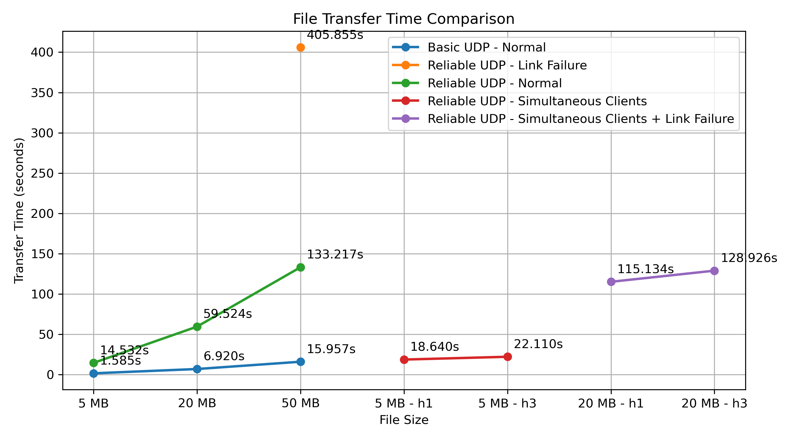
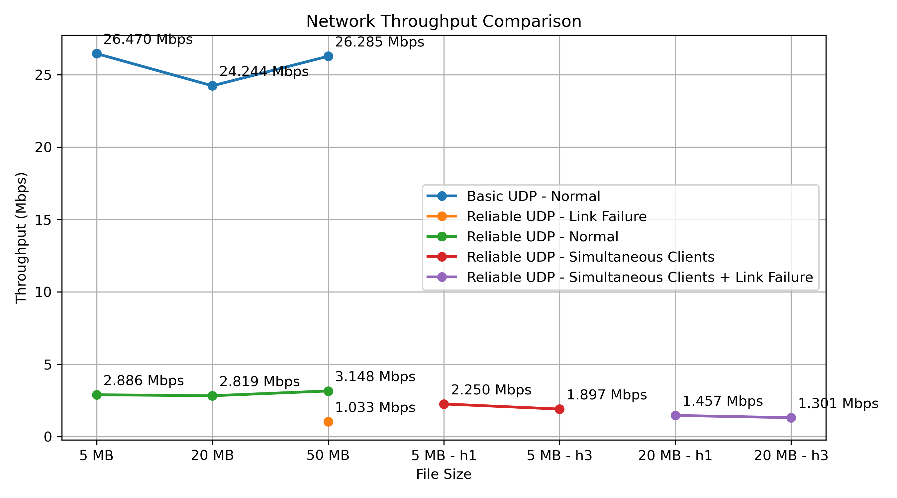
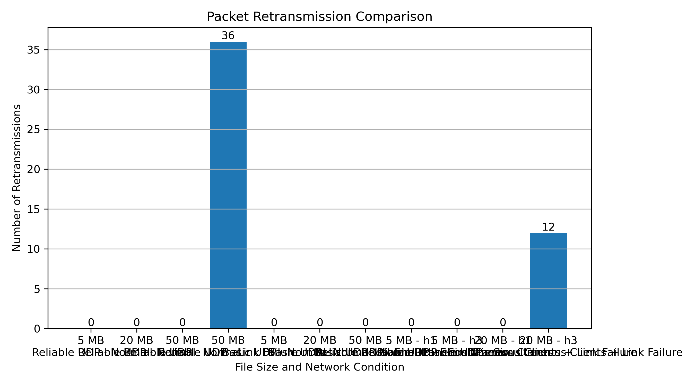
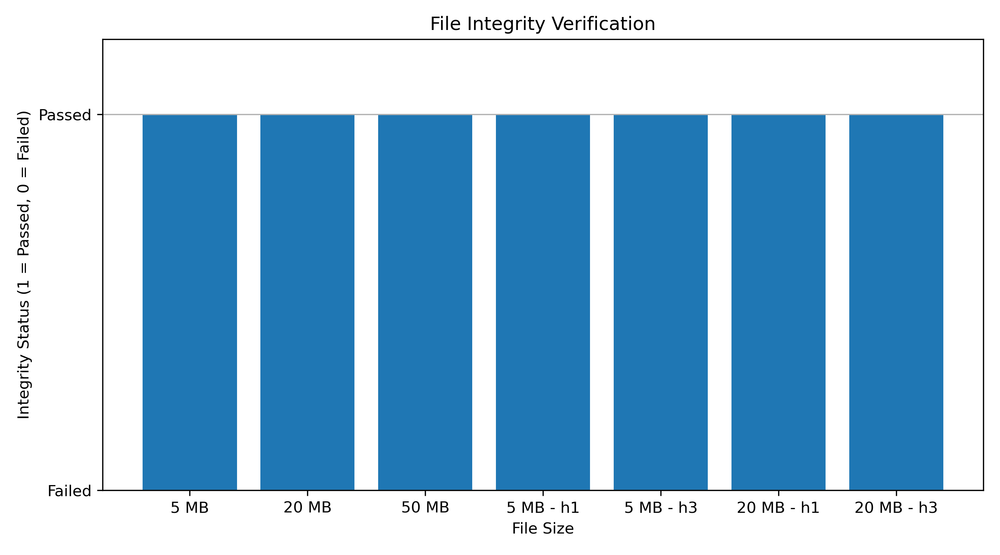

# Reliable File Transfer using UDP and SDN

A reliable file transfer application built using Python UDP sockets and Software-Defined Networking (SDN). The project implements application-layer reliability and dynamic network path management using an OS-Ken OpenFlow controller and Mininet.

## 1. Project Overview

UDP is a connectionless transport protocol that does not guarantee packet delivery, ordering or retransmission.

This project addresses these limitations by implementing a reliability mechanism at the application layer. It uses sequence numbers, acknowledgements, timeout-based retransmissions, duplicate packet detection and SHA-256 file integrity verification.

The project also integrates an SDN controller to detect network link failures and dynamically switch traffic between primary and backup paths.

## 2. Objectives

- Implement reliable file transfer using UDP sockets.
- Implement packet sequence numbering and acknowledgements.
- Detect missing and duplicate packets.
- Implement timeout-based retransmission.
- Verify received files using SHA-256.
- Create a Mininet network with primary and backup paths.
- Implement dynamic forwarding using OpenFlow 1.3.
- Detect link failures and restore network connectivity.
- Evaluate file transfer performance under different conditions.

## 3. System Architecture

The project contains four major components:

1. **UDP Client:** Reads files, divides them into packets and transmits them.
2. **UDP Server:** Receives packets, sends acknowledgements and reconstructs files.
3. **Reliability Protocol:** Handles sequence numbers, ACKs, retransmissions, duplicate detection and integrity verification.
4. **SDN Controller:** Manages network forwarding rules and selects available paths.

### Network Topology

The Mininet topology consists of three hosts and four OpenFlow switches. Hosts h1 and h3 act as UDP clients, while h2 runs the UDP server. The server supports simultaneous transfers from multiple clients.

**Primary path:**

`h1 → s1 → s2 → s4 → h2`

**Backup path:**

`h1 → s1 → s3 → s4 → h2`

When the primary path fails, the controller selects the backup path. When the failed link is restored, it reinstalls the primary forwarding path. Both clients are supported on the primary and backup routes.

## 4. Technologies Used

| Technology | Purpose |
|---|---|
| Python | Client, server and protocol implementation |
| UDP sockets | File transmission |
| Mininet | Network emulation |
| Open vSwitch | Software switches |
| OS-Ken | SDN controller |
| OpenFlow 1.3 | Controller-switch communication |
| SHA-256 | File integrity verification |
| NumPy | Numerical operations |
| Matplotlib | Performance graphs |
| Ubuntu | Development environment |
| VirtualBox | Virtual machine environment |

## 5. Project Structure

```text
Reliable-File-Transfer-using-UDP-and-SDN/
│
├── client/
│   ├── __init__.py
│   └── udp_client.py
│
├── server/
│   ├── __init__.py
│   └── udp_server.py
│
├── protocol/
│   ├── __init__.py
│   └── reliability.py
│
├── controller/
│   ├── __init__.py
│   └── sdn_controller.py
│
├── topology/
│   ├── __init__.py
│   └── topology.py
│
├── test_files/
│   ├── sample.txt
│   └── sample.bin
│
├── received_files/
│
├── logs/
│
├── results/
│   ├── performance_results.csv
│   ├── generate_graphs.py
│   └── graphs/
│
├── screenshots/
│
├── requirements.txt
├── .gitignore
└── README.md
```

Generated received files and large generated test files are excluded from Git using `.gitignore`.

## 6. Prerequisites

- Ubuntu Linux
- Python 3
- Mininet
- Open vSwitch
- OS-Ken
- Git
- Matplotlib
- NumPy

The SDN controller uses a separate Python virtual environment to run OS-Ken.

## 7. Installation

### Step 1: Install system dependencies

```bash
sudo apt update
sudo apt install python3 python3-pip python3-venv git mininet openvswitch-switch -y
```

### Step 2: Create the OS-Ken virtual environment

```bash
python3 -m venv --system-site-packages ~/osken-venv
source ~/osken-venv/bin/activate
```

### Step 3: Install controller dependencies

```bash
pip install os-ken==3.1.1 eventlet==0.36.1
```

### Step 4: Install project dependencies

From the project directory:

```bash
cd ~/Reliable-File-Transfer-SDN
pip install -r requirements.txt
```

## 8. Running the Project

The system uses three terminals.

### Terminal 1: Start the SDN Controller

```bash
cd ~/Reliable-File-Transfer-SDN

source ~/osken-venv/bin/activate

export PYTHONPATH="$HOME/Reliable-File-Transfer-SDN:$PYTHONPATH"

osken-manager --ofp-tcp-listen-port 6653 controller.sdn_controller
```

The controller connects to the four OpenFlow switches and installs forwarding rules.

### Terminal 2: Start Mininet

```bash
cd ~/Reliable-File-Transfer-SDN

sudo mn -c

sudo python3 topology/topology.py --remote
```

At the Mininet prompt, test connectivity:

```bash
h1 ping -c 5 10.0.0.2
```

### Terminal 3: Start the UDP Server

At the `mininet>` prompt:

```bash
h2 sh -c 'cd $HOME/Reliable-File-Transfer-SDN && PYTHONPATH=$HOME/Reliable-File-Transfer-SDN python3 -u -m server.udp_server > logs/server_mininet.log 2>&1 &'
```

### Transfer a File

At the `mininet>` prompt:

```bash
h1 sh -c 'cd $HOME/Reliable-File-Transfer-SDN && PYTHONPATH=$HOME/Reliable-File-Transfer-SDN python3 -m client.udp_client test_files/sample.txt --host 10.0.0.2'
```

The client sends the file through the Mininet network. The server reconstructs the file and verifies its integrity.

## 9. SDN Failure and Recovery Demonstration

To monitor connectivity continuously:

```bash
h1 ping 10.0.0.2 > /tmp/phase5_ping.log 2>&1 &
```

Disconnect the primary link at the Mininet prompt:

```bash
link s1 s2 down
```

The controller detects the failure and activates the backup path:

`h1 → s1 → s3 → s4 → h2`

Inspect the backup forwarding rules:

```bash
sh ovs-ofctl -O OpenFlow13 dump-flows s1
sh ovs-ofctl -O OpenFlow13 dump-flows s3
sh ovs-ofctl -O OpenFlow13 dump-flows s4
```

Restore the primary link:

```bash
link s1 s2 up
```

The controller detects restoration and reinstalls the primary forwarding path.

Stop the background ping:

```bash
h1 killall ping
```

## 10. Reliability Features

- **Sequence Numbers:** Identify individual data packets.
- **Acknowledgements:** Confirm successful packet reception.
- **Timeouts:** Detect missing acknowledgements.
- **Retransmissions:** Resend packets when acknowledgements are not received.
- **Duplicate Detection:** Prevent duplicate packet storage.
- **SHA-256:** Verify the integrity of the reconstructed file.

The implemented configuration uses a window size of 5 and an acknowledgement timeout of 0.5 seconds.

## 11. Performance Evaluation

The application was evaluated using Basic UDP and Reliable UDP under different file sizes and network conditions.

### Performance Results

| File Size | Network Condition | Transfer Time (s) | Throughput (Mbps) | Retransmissions | Integrity |
|---|---|---:|---:|---:|---|
| 5 MB | Basic UDP - Normal | 1.585 | 26.470 | 0 | FAILED |
| 5 MB | Reliable UDP - Normal | 14.532 | 2.886 | 0 | PASSED |
| 20 MB | Basic UDP - Normal | 6.920 | 24.244 | 0 | FAILED |
| 20 MB | Reliable UDP - Normal | 59.524 | 2.819 | 0 | PASSED |
| 50 MB | Basic UDP - Normal | 15.957 | 26.285 | 0 | PASSED |
| 50 MB | Reliable UDP - Normal | 133.217 | 3.148 | 0 | PASSED |
| 50 MB | Reliable UDP - Link Failure | 405.855 | 1.033 | 36 | PASSED |

**Note:** Basic UDP transfer time represents the sender-side transmission duration, whereas Reliable UDP transfer time represents the acknowledged transfer duration. Therefore, these timings are not directly equivalent. Basic UDP does not use application-level acknowledgements or retransmissions.

### Observations

- Basic UDP achieved higher sending throughput but lost packets in the 5 MB and 20 MB tests.
- Reliable UDP successfully reconstructed and verified all tested files.
- The 50 MB Basic UDP test completed successfully, demonstrating that packet loss is dependent on network conditions.
- During the 50 MB link-failure test, Reliable UDP recorded 36 retransmissions and maintained file integrity.
- The link-failure test took longer because of the network disruption and recovery process.

### Simultaneous Client Testing

Two clients were tested concurrently against the same UDP server.

| Client | File Size | Transfer Time (s) | Throughput (Mbps) | Retransmissions | Integrity |
|---|---:|---:|---:|---:|---|
| h1 | 5 MB | 18.640 | 2.250 | 0 | PASSED |
| h3 | 5 MB | 22.110 | 1.897 | 0 | PASSED |

The server recorded two active sessions and reconstructed both files
using separate transfer IDs and output filenames. Both SHA-256 checks
matched their respective original files.

### Simultaneous Clients During SDN Link Failure

Two 20 MB transfers were active when the primary link between s1 and s2
was disconnected. The controller detected the failure and installed
forwarding rules through the backup path s1 -> s3 -> s4.

| Client | File Size | Transfer Time (s) | Throughput (Mbps) | Retransmissions | Integrity |
|---|---:|---:|---:|---:|---|
| h1 | 20 MB | 115.134 | 1.457 | 0 | PASSED |
| h3 | 20 MB | 128.926 | 1.301 | 12 | PASSED |

Both transfers completed. The server verified both reconstructed files,
and their SHA-256 hashes matched the originals. The controller log recorded
the primary link failure and activation of the backup route.

These measurements were collected in a Mininet/VirtualBox environment.
They represent individual client results, not aggregate throughput.

### Performance Graphs

The generated graphs are available in `results/graphs/`.

#### Transfer Time


#### Throughput


#### Retransmissions


#### Integrity Verification


## 12. File Integrity Verification

The original and received files can be compared using SHA-256:

```bash
sha256sum test_files/failure_test.bin
sha256sum received_files/failure_test_31c50ebd.bin
```

Matching hashes indicate that the original and received file contents are identical.

## 13. Logs and Results

- `logs/` contains server and client execution logs.
- `results/performance_results.csv` contains the measured performance data.
- `results/graphs/` contains generated performance graphs.
- `screenshots/` contains implementation and testing evidence.

## 14. Limitations

- The current topology uses two UDP clients and one UDP server.
- Performance measurements depend on the virtual machine resources and
  emulated network conditions.
- The current timeout and sliding-window parameters are fixed rather than
  dynamically adjusted.
- Testing has focused on the configured primary and backup paths and the
  demonstrated concurrent-client scenarios.
## 15. Future Enhancements

- Support a larger number of simultaneous clients.
- Implement adaptive timeout and window sizing.
- Introduce congestion-aware transmission.
- Evaluate additional network topologies and failure scenarios.
## 16. Conclusion

This project demonstrates reliable file transmission using UDP with application-layer reliability mechanisms and SDN-based network path management.

Sequence numbers, acknowledgements, retransmissions and duplicate detection provide reliable packet handling. SHA-256 verifies the integrity of received files.

The OS-Ken controller manages OpenFlow switches and dynamically selects primary or backup forwarding paths during link failures.

The implementation was evaluated under normal and link-failure conditions using different file sizes, and the results were recorded through CSV data and performance graphs.
